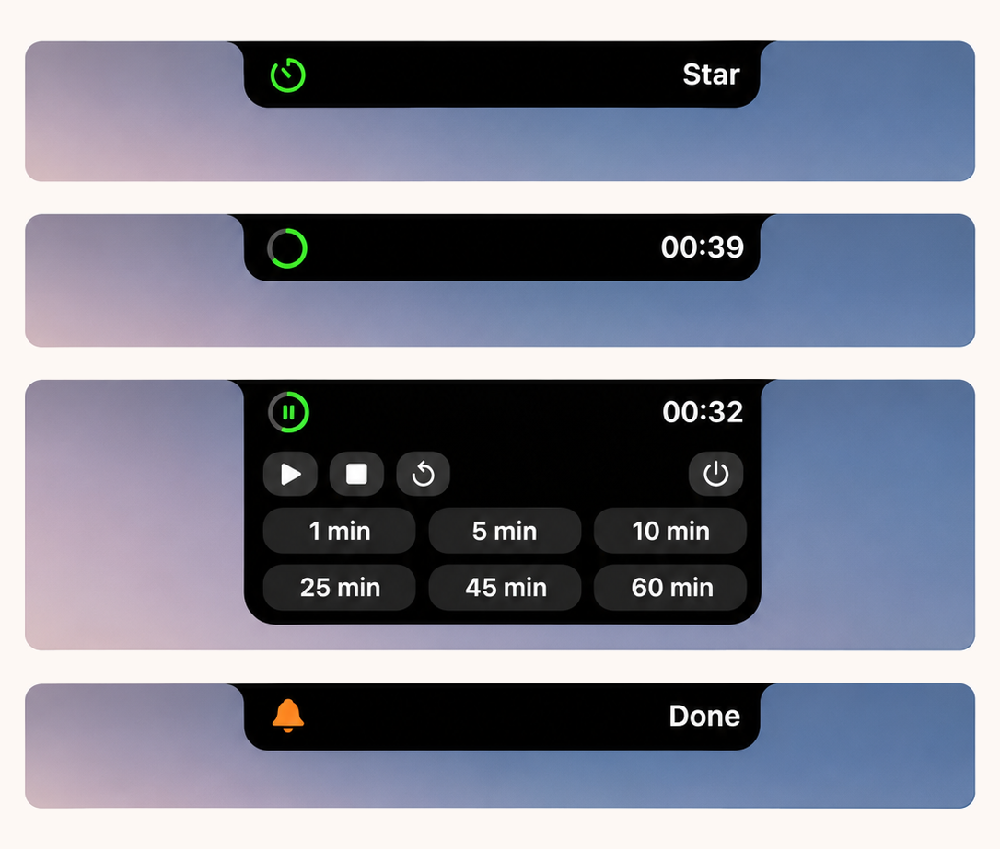

# ⏱️ 刘海倒计时 · CountdownIsland

> **把 Mac 的刘海做成一块「灵动半岛」**
> **Turn your Mac's notch into a dynamic island countdown**
>
> 收起看倒计时，点开选时长、暂停或重置。时间一到，半岛和小铃铛一起摇，点一下才停。
> Collapsed it counts down; expanded it picks a duration, pauses or resets. When time's up, the island and its bell shake together — until you tap it.



*待开始 · 计时中 · 展开控制 · 时间到　Idle · Running · Expanded · Done*

**macOS 13+ · 单文件 Swift 552 行 · 零第三方依赖 · 无需申请任何权限**

---

## 这是什么 · What is this

**中文**：刘海倒计时是一个极简的 macOS 桌面小工具。它不弹窗、没有主界面、不打断你——就是一块贴着屏幕刘海的黑色「岛」，收起时安安静静显示 `mm:ss`，点一下展开就能选 1 / 5 / 10 / 25 / 45 / 60 分钟，暂停、继续、停止、重置都在一步之内。时间到，铃声响起，岛体和铃铛用同一条正弦波形一起震动，直到你点它一下为止。

为什么叫「半岛」？因为它只有上边缘和屏幕贴齐，下面是手绘的弧线——像一块从刘海垂下来的陆地。系统原生的灵动岛只给 Apple 自己用，这个是照着它的形，自己画了一块。

**English**: CountdownIsland is a minimal macOS utility. No Dock clutter, no popups, no main window — just a black "island" hugging your notch. Collapsed, it quietly counts down `mm:ss`; tap it and it expands to 1 / 5 / 10 / 25 / 45 / 60-minute presets with pause, stop and reset one click away. When time is up, a chime plays and both the island and the bell shake on the same waveform until you tap to acknowledge.

Built in a single Swift file (552 lines) with AppKit + SwiftUI. No third-party dependencies, no permissions, no background services.

---

## ✨ 功能 · Features

| 功能 Feature | 说明 Description |
|---|---|
| 🕳️ 贴着刘海的岛体 | 宽度按硬件刘海实测反推，高度取 `safeAreaInsets.top`，上下边缘与刘海严格对齐 |
| 🎛️ 点开即用 | 单击展开/收起，6 档预设时长（1 / 5 / 10 / 25 / 45 / 60 min） |
| ⭕ 环形进度 | 计时中左侧是绿色圆弧进度圈，右侧是白色 `mm:ss` 等宽数字 |
| ⏸️ 随时接管 | 暂停 / 继续 / 停止 / 重置，全部在展开面板第一行 |
| 🔔 到点叫你 | `Glass` 提示音 + 岛体与铃铛同相位震动，**不点不停** |
| 🖱️ 点击穿透 | 只有岛体本身吃鼠标，其余区域的点击原样传给下层窗口 |
| 🖥️ 多显示器 / 分辨率切换 | 监听屏幕参数变化，自动重新测量刘海并重排 |
| 🚪 安静退出 | 面板最右电源键退出；关闭后从程序坞点图标即可重新唤起 |

---

## 🚀 快速开始 · Quick Start

### 方式一：从源码构建（推荐，10 秒）

需要 macOS 13+ 和 Xcode Command Line Tools（`xcode-select --install`）。

```bash
git clone https://github.com/Libailin222/CountdownIsland.git
cd CountdownIsland
./build.sh
open CountdownIsland.app
```

`build.sh` 做的事很简单：`swiftc` 编译单个源文件 → 拷贝 `Info.plist` 与图标 → ad-hoc 签名。产物是当前机器架构的 `CountdownIsland.app`，可以直接拖进「应用程序」文件夹。

### 方式二：自己手动编译

```bash
swiftc -O -swift-version 5 main.swift -o CountdownIsland.app/Contents/MacOS/CountdownIsland \
  -framework AppKit -framework SwiftUI -framework Combine
codesign --force --sign - CountdownIsland.app
```

> ⚠️ 首次打开若提示「无法验证开发者」，右键 → 打开，或在「系统设置 → 隐私与安全性」里选择「仍要打开」。因为用的是本地 ad-hoc 签名，没有开发者证书。

---

## 🕹️ 怎么用 · How to use

| 动作 Action | 结果 Result |
|---|---|
| 单击岛体 | 收起 / 展开（到点震动时单击 = 停止震动并展开） |
| 展开后点 `1/5/10/25/45/60 min` | 立即开始对应时长的倒计时，岛体自动收起 |
| 计时中点 ⏸ | 暂停，圆弧上显示暂停图标 |
| 计时中点 ⏹ | 停止并回到待开始 |
| 计时中点 ↺ | 用同一时长重新开始 |
| 点电源图标 / 右键菜单「关闭倒计时」 | 退出整个 App |
| 点岛体以外的任何地方 | 展开的面板自动收起 |

**状态流转 State machine**：

```
待开始 idle ⇄ 展开 picking ──start(m)──▶ 计时中 running
                                            │  ⏸
                                            ▼
                                         暂停 paused ──▶ 继续 running
                                            │
                                        归零 ▼
                                          到时 done ⇄ 点击 acknowledge → idle
```

---

## 🧠 实现要点 · How it works

真正难的不是计时器，是「让一个窗口看起来长在刘海上」。几个关键点：

| 问题 Problem | 做法 Approach |
|---|---|
| 刘海到底多宽多高？ | 用 `auxiliaryTopLeftArea` / `auxiliaryTopRightArea` 的宽度差反推刘海宽度，`safeAreaInsets.top` 取刘海高度；没有刘海的显示器回落到 150×26 的顶部条 |
| 怎么浮在菜单栏之上？ | `NSPanel.level = .statusBar` + 子类化 `NSPanel` 覆写 `constrainFrameRect`，阻止系统把窗口「按回」可见区域 |
| 怎么只让岛体吃鼠标？ | 子类化 `NSHostingView` 覆写 `hitTest`：只有岛体矩形内返回命中，其余返回 `nil`，点击直接穿透 |
| 为什么往下偏 1pt？ | 窗口贴到屏幕外沿会被裁掉一条，多给 1pt 让下边缘正好压在硬件边缘上 |
| 圆弧怎么和刘海连续？ | `IslandShape` 手绘 Path：顶部两侧用三次贝塞尔做「肩部」，底部单一圆角；只对 `bottomRadius` 做动画 |
| 震动怎么不穿帮？ | 铃铛摆角与岛体位移共用同一条正弦波形，放在同一个 `withAnimation` transaction 里，保证同相位 |
| 换了显示器怎么办？ | 监听 `didChangeScreenParametersNotification`，重新测量 → 重建视图 → 重排窗口 |

---

## 🏗️ 项目结构 · Structure

```
CountdownIsland/
├── main.swift          # 全部代码：计时模型 + 岛体图形 + 窗口宿主（552 行）
│   ├── CountdownModel  # 状态机、Timer、到点震动波形
│   ├── IslandShape     # 手绘「半岛」路径
│   ├── IslandRoot      # SwiftUI 界面（收起 / 展开两态）
│   └── AppDelegate     # NSPanel 宿主、点击穿透、屏幕测量
├── Info.plist          # Bundle 配置（版本号、最低系统 13.0）
├── AppIcon.icns        # 应用图标
├── build.sh            # 一行命令编译 + 签名
└── docs/preview.png    # README 预览图
```

**技术栈 Tech Stack**：Swift 5 · SwiftUI · AppKit（NSPanel / NSHostingView / NSEvent）· 无任何第三方库

---

## ⚙️ 自定义 · Customize

全部改在 `main.swift` 里，改完跑一次 `./build.sh` 即可。

| 想改什么 | 改哪里 |
|---|---|
| 预设时长 | `IslandRoot` 里的 `presets = [1, 5, 10, 25, 45, 60]` |
| 主题色（默认 `#32D74B`） | 文件顶部 `themeGreen` |
| 提示音 | `CountdownModel.finish()` 里的 `NSSound(named: "Glass")` |
| 震动强度 | `finish()` 中的 `shake = wave * 4` 与 `bellAngle = wave * 18` |
| 岛体胖瘦 | `islandWidth()` 里的 `notch + 112` / `notch + 120` |

---

## ❓ 常见问题 · FAQ

**Q：会挡住菜单栏吗？**
不会。岛体宽度是「刘海宽度 + 112pt」，只在中间那一小段；超出的区域通过 `hitTest` 让点击穿透，菜单栏图标照常可点。

**Q：外接显示器没有刘海怎么办？**
回落到顶部居中的 150×26 小条，功能完全一样。切换显示器时窗口会自动重新测量并归位。

**Q：需要辅助功能权限吗？**
不需要授权任何隐私权限。全局鼠标监听用的是 `NSEvent.addGlobalMonitorForEvents`（仅鼠标事件，不需要辅助功能信任），用途只是「点别处自动收起」。

**Q：为什么它出现在程序坞里？**
因为用的是 `.regular` 激活策略（`LSUIElement = false`）。这样关掉计时后点图标就能重新唤起；不想要可以改成 `LSUIElement = true`，它就会变成一个纯后台小工具。

**Q：App 里那个 `Star` 是什么？**
待开始状态右侧的占位文案，写死在 `IslandRoot` 里，改成 `Ready`、`计时` 或你喜欢的任何词都可以。😅

**Q：能上 Mac App Store 吗？**
不建议。它依赖 `level = .statusBar` 的窗口和全局事件监听，沙盒下行为受限，属于典型的「自己编译自己用」工具。

---

## 🗺️ Roadmap

- [ ] 自定义时长输入（不只 6 档预设）
- [ ] 菜单栏常驻图标，不占程序坞
- [ ] 番茄钟循环（25 + 5 自动接续）
- [ ] 通用二进制（arm64 + x86_64 一次构建）
- [ ] 结束时发系统通知，带走开按钮

---

## 📄 许可 · License

[MIT License](LICENSE) © 李柏霖 / Libailin222

随便用、随便改、随便发。如果它帮你少看了几次手机，欢迎来个 ⭐。

---

<a name="english"></a>
## English

**CountdownIsland** turns your MacBook's notch into a tiny countdown "island". Collapsed, it counts down `mm:ss` right next to the camera housing; tap it and it expands to six presets (1 / 5 / 10 / 25 / 45 / 60 min) with pause, stop and reset. When the timer hits zero it chimes and the island plus its bell shake in phase until you tap to dismiss.

It's a single Swift file — AppKit + SwiftUI, no dependencies, no permissions, no background daemon. The interesting part isn't the timer: it's measuring the real notch with `auxiliaryTopLeftArea` / `auxiliaryTopRightArea`, floating a `NSPanel` above the menu bar by overriding `constrainFrameRect`, and letting clicks pass through everything except the island itself via a custom `hitTest`.

**Build**: `git clone` → `./build.sh` → `open CountdownIsland.app`. Requires macOS 13+ and Xcode Command Line Tools. Ad-hoc signed, so right-click → Open on first launch.

**Customize**: presets, accent color, chime and shake intensity are all plain constants at the top of `main.swift`.

MIT licensed. Do whatever you want with it.

---

## 🔗 相关链接 · Links

- 项目仓库 Repo：https://github.com/Libailin222/CountdownIsland
- 小红书：见评论区 / see comments
